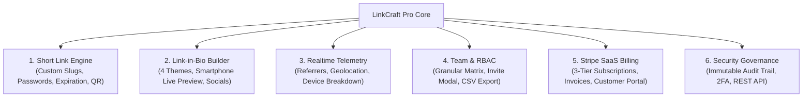

<div align="center">

# ⚡ LinkCraft Pro v2.0
### Enterprise URL Management, Branded Short Links, Link-in-Bio & Click Telemetry Platform

[](https://nextjs.org/)
[](https://react.dev/)
[](https://www.typescriptlang.org/)
[](https://www.prisma.io/)
[](https://stripe.com/)
[](https://github.com/KipTecnologia)

<p align="center">
  <a href="https://kiptecnologia.github.io/linkcraft-pro/"><strong>🌐 Test Interactive Live Demo</strong></a> •
  <a href="https://kiptecnologia.gumroad.com/l/linkcraft-pro"><strong>🛒 Purchase Commercial License ($49)</strong></a> •
  <a href="https://kiptecnologia.gumroad.com/l/5-in-one"><strong>📦 5-in-1 Complete Bundle ($99)</strong></a>
</p>

</div>

---

## 📌 Executive Overview

**LinkCraft Pro v2.0** is an enterprise-grade URL shortener, branded link management, link-in-bio page builder, and real-time click telemetry micro-SaaS boilerplate. 

Engineered strictly following Kip Tecnologia's Clean Light & Carbon Slate executive design standard, it replaces costly SaaS tools like Bitly ($35/mo), Dub.co ($24/mo), and Linktree ($10/mo) with a unified, self-hosted or SaaS-ready codebase that you own 100%.

---

## 🚀 Key Architectural Modules



### 1. Branded Short Links & QR Code Generator
- **Custom Slugs**: Shorten URLs with your custom domain (`kip.to/launch`).
- **Security & Protection**: Optional password protection and expiration dates.
- **Dynamic QR Codes**: On-the-fly client-side vector QR code rendering with 1-click PNG download.
- **Client-Side CSV Export**: Instant export of link records and click counts.

### 2. Interactive Link-in-Bio Profile Builder
- **Real-Time Smartphone Preview**: Visual interactive iPhone mockup updates live as you type.
- **4 Premium Themes**: Clean Light (Linear-inspired default), Carbon Slate (Dark executive), Sunset Violet, and Emerald Minimal.
- **Custom Buttons & Social Handles**: Add, reorder, and link to X, GitHub, YouTube, LinkedIn, and WhatsApp.

### 3. Click Telemetry & Traffic Trajectory
- **Interactive SVG Vector Chart**: Real-time traffic trajectory with period filters (`7D`, `30D`, `90D`, `12M`).
- **Audience Insights**: Traffic referrers (Twitter, LinkedIn, Direct), Geographic distribution (US, BR, DE, UK), and device breakdown (Mobile 62%, Desktop 34%).

### 4. Enterprise RBAC Permissions
- **Granular Roles**: Workspace Owner, Administrator, Marketing Lead, Growth Analyst, Billing Admin.
- **Team Directory**: Filterable collaborator directory with search and native CSV export.
- **Invite Modal**: Real-time collaborator invitation workflow.

### 5. Stripe Recurring SaaS Subscriptions
- **3-Tier Pricing Architecture**: Starter ($9/mo), Pro ($29/mo), Enterprise ($79/mo).
- **Billing History**: Invoice table with simulated PDF/text receipts.
- **Payment Method Management**: Stripe Customer Portal integration.

### 6. Security Governance & REST API
- **Immutable Audit Trail**: Filterable event log with severity badges (INFO, WARNING, SECURITY) and 1-click JSON export.
- **Production REST API**: Bearer token authentication with 1-click key regeneration.
- **Webhook Dispatcher**: Outbound HTTP webhooks for real-time click and conversion event streaming.

### 7. Universal Design & Usability Standards
- **Bilingual Engine**: Instant 1-click switch between **English (🇺🇸)** and **Portuguese (🇧🇷)** across 100% of the UI.
- **Theme Modes**: High-density **Clean Light** executive mode and **Carbon Slate** dark mode.
- **Command Palette (`⌘K` / `Ctrl+K`)**: Keyboard-driven quick navigation.
- **Zero Browser Alerts**: Fully styled contextual modals and floating toast alerts.

---

## 🛠️ Quickstart & Local Setup

### Prerequisites
- Node.js 20+ LTS or 22+
- PostgreSQL database (or Supabase / Neon / Docker)

### Installation

```bash
# 1. Clone repository
git clone https://github.com/KipTecnologia/linkcraft-pro.git
cd linkcraft-pro

# 2. Install dependencies
npm install

# 3. Configure environment variables
cp .env.example .env.local

# 4. Run Prisma database migrations
npx prisma generate
npx prisma migrate dev --name init

# 5. Start development server
npm run dev
```

Open [http://localhost:3000](http://localhost:3000) to view LinkCraft Pro.

---

## 📂 Source Code Structure

```text
linkcraft-pro/
├── prisma/
│   └── schema.prisma         # Multi-tenant Prisma models (Links, Bio, Users, Stripe, Audit)
├── src/
│   ├── app/
│   │   ├── api/
│   │   │   ├── links/        # Link shortening, listing, updates & soft-deletes
│   │   │   ├── bio/          # Link-in-bio profiles & button order management
│   │   │   ├── stripe/       # Checkout sessions & webhook handlers
│   │   │   ├── audit/        # Immutable security logs & filter queries
│   │   │   └── users/        # Team members & RBAC invitations
│   │   └── layout.tsx
│   └── lib/
│       ├── db.ts             # Prisma Client singleton
│       └── stripe.ts         # Stripe SDK client
├── index.html                # Standalone interactive evaluation prototype
├── package.json              # Next.js 15, React 19, TypeScript Strict, Prisma, Stripe
└── LICENSE                   # Kip Tecnologia Commercial & Evaluation License v2.0
```

---

## 📄 License & Distribution

This project is licensed under the **Kip Tecnologia Commercial & Evaluation License (v2.0)**.
- **Public Demos & Review**: Free for evaluation, benchmarking, and review under the Kip Tecnologia organization.
- **Commercial Production Use**: Requires an official commercial license purchased via [Gumroad](https://kiptecnologia.gumroad.com/l/linkcraft-pro) or the [5-in-1 Bundle](https://kiptecnologia.gumroad.com/l/5-in-one).

**Contact**: [contato@kiptecnologia.com.br](mailto:contato@kiptecnologia.com.br) • **Website**: [github.com/KipTecnologia](https://github.com/KipTecnologia)
